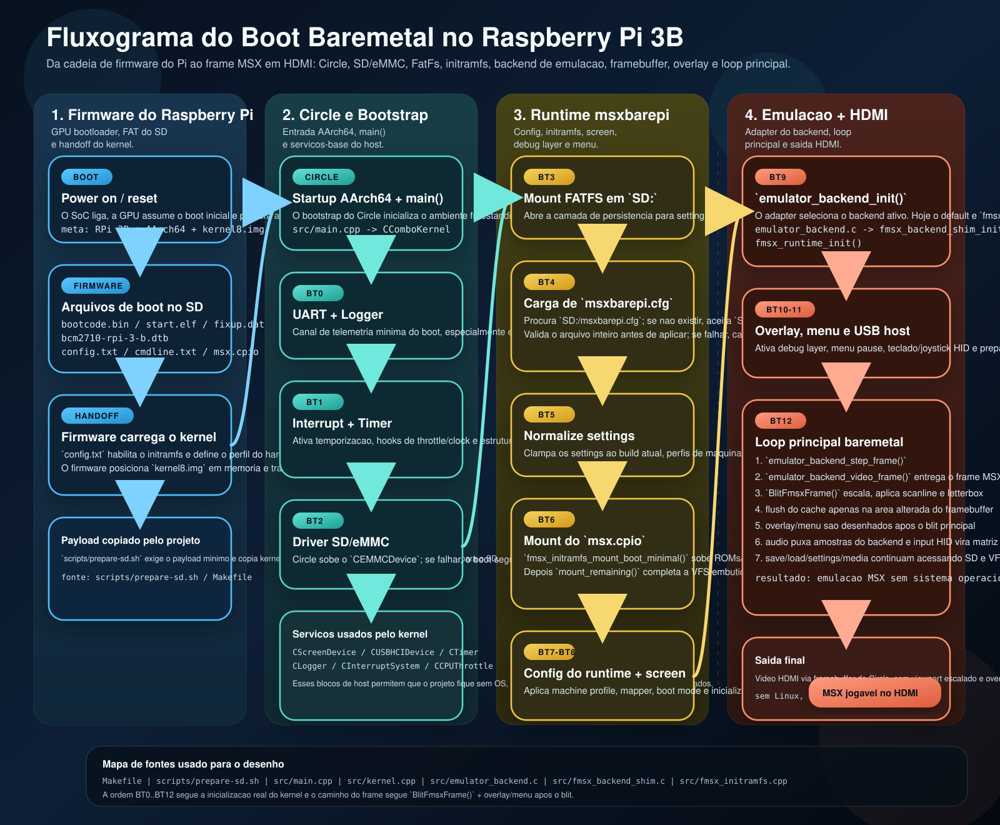

# Fluxograma do boot baremetal no Raspberry Pi 3B

## Objetivo

Registrar, em uma unica arte, como a carga do `msxbarepi` sai do firmware do Raspberry Pi e chega ao ponto em que a emulacao MSX ja esta rodando com video, input, audio, menu e debug layer no mesmo kernel baremetal.

## Leitura rapida

1. O firmware do Raspberry Pi le os arquivos da particao FAT do SD e entrega o controle para `kernel8.img`.
2. O bootstrap do Circle sobe o ambiente baremetal AArch64 e entra em `main()`, que instancia `CComboKernel`.
3. O kernel sobe `UART + Logger`, `Interrupt + Timer` e o driver `SD/eMMC` antes de tocar o runtime do emulador.
4. Com o SD pronto, o projeto monta `FatFs`, le `msxbarepi.cfg`, normaliza os settings e monta o `initramfs` (`msx.cpio`) com ROMs e midias de boot.
5. So depois disso o `CScreenDevice` e o framebuffer HDMI entram no ar e o adapter de backend inicializa o `fMSX`.
6. O loop principal faz `step_frame`, blit do frame para o framebuffer, aplica scanline/viewport, desenha overlay/menu apos o blit e mistura audio/input no mesmo ciclo.

## Fontes tecnicas usadas

- `scripts/prepare-sd.sh`
- `Makefile`
- `src/main.cpp`
- `src/kernel.cpp`
- `src/emulator_backend.c`
- `src/fmsx_backend_shim.c`
- `src/fmsx_initramfs.cpp`

## Observacoes de modelagem

- O diagrama mostra `BT4` como bloco proprio porque a carga de `msxbarepi.cfg` e um gate funcional do boot, mesmo acontecendo dentro de `LoadSettingsFromStorage()`.
- `BT9` passa pelo adapter de `src/emulator_backend.c` para deixar explicito que o runtime do projeto nao depende diretamente de um unico core, embora hoje o default seja `fmsx`.
- A parte de video foi desenhada com a ordem real do kernel: o frame do backend e blitado primeiro e so depois entram overlay e menu, preservando a legibilidade em HDMI.
